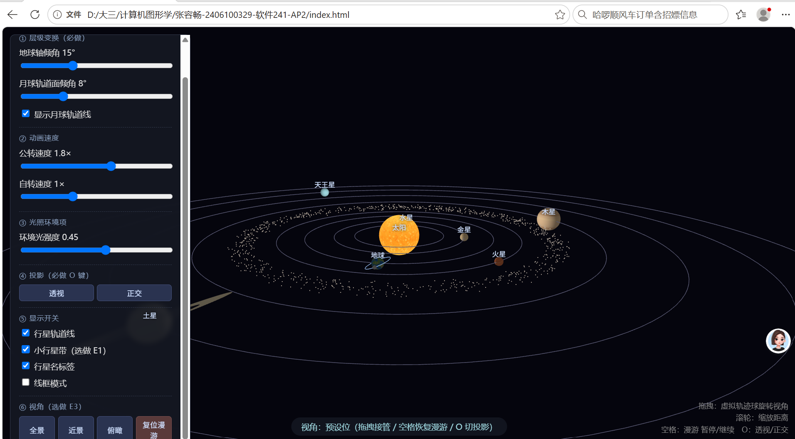
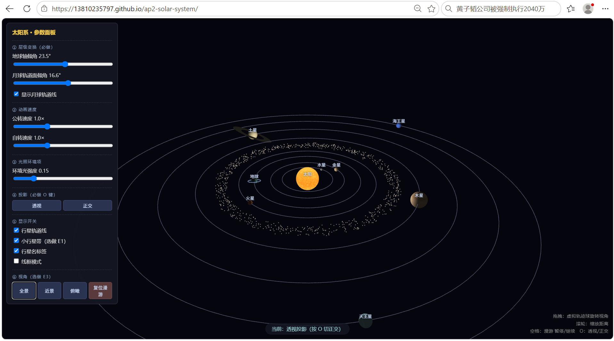
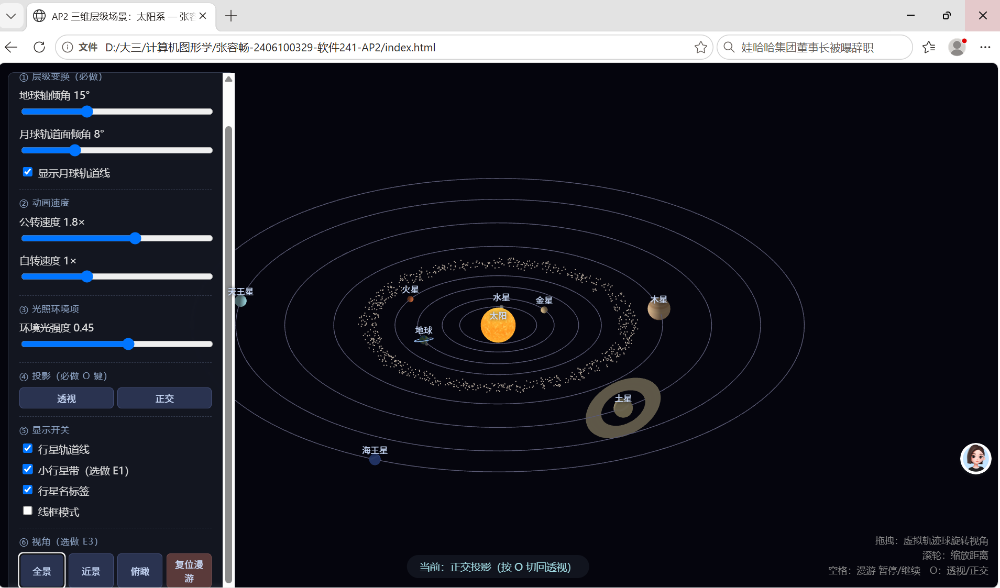
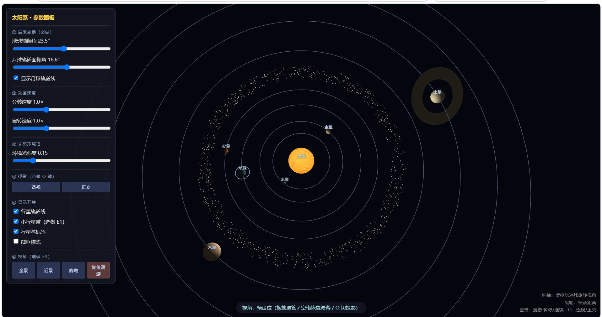

# AP2 · 三维层级场景：太阳系

> 课程：计算机图形学（Angel & Shreiner, *Interactive Computer Graphics*, 8th ed.）
> 学生：张容畅　学号：2406100329　班级：软件 241
> 技术栈：原生 WebGL 2.0 + JavaScript，教材配套工具库（`Common/` 下 `initShaders.js` / `MV.js` / `webgl-utils.js`），无构建步骤。

---

## 一、运行方式

任意静态服务器托管本目录即可（不要直接双击 `index.html`，因为要走 HTTP 加载 JS）：

```bash
# 在本目录下任选一种
python -m http.server 8000
# 或
npx serve .
```

浏览器打开 `http://localhost:8000/`。推荐 Chrome / Edge。

目录结构：

```
├── index.html            # 页面 + 参数面板
├── Common/               # 教材配套工具库
│   ├── MV.js             #   mat4/vec 矩阵数学（含 hand-made 矩阵的基本变换）
│   ├── initShaders.js    #   着色器编译链接
│   └── webgl-utils.js    #   获取上下文 / 高分屏适配
├── js/
│   ├── shaders.js        # 三套着色器（纹理天体 / 轨道线 / 小行星点）
│   ├── sphere.js         # UV 球 + 土星环带 + 轨道圆 几何生成
│   ├── textures.js       # Canvas 程序化位图 → gl.texImage2D
│   ├── scene.js          # 所有天体参数集中配置（半径/距离/周期/倾角）
│   ├── camera.js         # 虚拟轨迹球 + 关键帧漫游
│   └── main.js           # 场景图 / 矩阵栈 / 主循环 / UI 绑定
└── screenshots/          # README 用截图
```

---

## 二、交互说明

| 操作                   | 效果                          |
| -------------------- | --------------------------- |
| 鼠标拖拽                 | 虚拟轨迹球（选做 E3）旋转视角，随时接管自动漫游   |
| 滚轮                   | 缩放视距                        |
| `空格`                 | 自动环绕漫游 暂停 / 继续              |
| `O`                  | 透视投影 ↔ 正交投影切换               |
| 公转速度滑条               | 0–3×，控制所有行星公转角速度            |
| 自转速度滑条               | 0–3×，控制所有天体自转角速度            |
| 地球轴倾角滑条              | 0–45°，实时改变地球自转轴倾角（默认 23.5°） |
| 环境光强度滑条              | 0–0.8，调亮行星背面（朗伯光照的环境项）      |
| 显示轨道线 / 小行星带 / 行星名标签 | 三个独立开关                      |
| 线框模式                 | 切换球体实体填充 ↔ 网格线框             |
| 全景 / 近景 / 俯瞰 / 复位漫游  | 视角预设按钮                      |

---

## 三、层级结构（变换嵌套树）

场景用一个简单的矩阵栈（`pushMV / popMV`）逐层左乘模型矩阵，表达"物体在物体之上"的依赖。渲染时的嵌套树如下：

```
世界（view）
└── 太阳  mv = view · Ry(自转) · S(1.0)
    │
    ├── 水星  mv = view · Ry(公转) · T(d) · Rx(倾角) · Ry(自转) · S(r)
    ├── 金星  …
    ├── 地球  mv = view · Ry(公转) · T(4.6)
    │   ├── 地球本体  mv = 上 · Rx(23.5°) · Ry(自转) · S(0.26)
    │   └── 月球      mv = 上 · [手动矩阵] · S(0.08)
    ├── 火星
    ├── 小行星带（世界坐标点云，不在行星节点下）
    ├── 木星
    ├── 土星  mv = view · Ry(公转) · T(12.2)
    │   ├── 土星本体  mv = 上 · Rx(26.7°) · Ry(自转) · S(0.55)
    │   └── 土星环    mv = 上 · Rx(26.7°)（挂在倾斜框架内，随轴倾不随自转）
    ├── 天王星
    └── 海王星
```

### 3.1 地球轴倾角——"先转后挂"

这是本题最关键的一点。地球的 23.5° 倾角必须先施加在**地球自身坐标系**上，再叠加公转轨道变换。对应代码（`main.js`）：

```js
// ① 公转：先绕 Y 转到轨道角，再沿 X 平移到轨道半径
mv = mult(mv, rotate(orbitAngle.earth, [0,1,0]));
mv = mult(mv, translate([4.6, 0, 0]));
// ② 进入地球自身坐标系：先 Rx(23.5°) 倾斜，再 Ry(自转)，最后缩放
mv = mult(mv, rotate(earthTilt, [1,0,0]));   // ← 倾角属于地球本体
mv = mult(mv, rotate(spinAngle.earth, [0,1,0]));
mv = mult(mv, scale([r, r, r]));
```

注意顺序：如果把 `Rx(23.5°)` 放到公转变换**之前**（外层），倾斜的就不是地球自转轴，而是整个公转轨道面——季节就错了。矩阵栈的 `push/pop` 保证了倾角只影响地球及其子节点（月球），不影响其他行星。

### 3.2 手动矩阵——月球轨道面倾角（必做点 2）

月球轨道面相对地球赤道面有 5.14° 倾角。这一处**没有**用任何封装好的复合函数，而是用 `MV.js` 的基本变换手工拼出。

关键点是**乘法顺序**。列向量约定下，顶点先被最右边的矩阵作用。要让月球先被 `T` 推到轨道半径、再被 `Rx` 把轨道面扳斜、最后被 `Ry` 绕地轴公转，矩阵必须写成左乘顺序 `Ry·Rx·T`：

```js
var RyMoon = rotate(moonAngle,   [0,1,0]);  // 基本旋转：绕地球极轴公转
var RxIncl = rotate(moonIncl,    [1,0,0]);  // 基本旋转：把整个轨道面扳斜
var TMoon  = translate([0.55,0,0]);         // 基本平移：沿局部 X 推到轨道半径
var moonFrame = mult(RyMoon, mult(RxIncl, TMoon));  // 左乘：Ry·Rx·T
```

> 踩过的坑：一开始误写成 `T·Rx·Ry`。由于旋转矩阵作用在原点上是恒等的（旋转不改变原点），月球球心永远停在 `T(0.55,0,0)`，`Ry` 只是把月球本身原地空转——结果月球一直贴在地球上，日-地-月像一条线。改成 `Ry·Rx·T` 后，月球才真正绕地球公转。面板上"月球轨道面倾角"滑条可实时调这个 `Rx` 角度，勾选"显示月球轨道线"可看到月球运行的椭圆轨道。



---

## 四、表面纹理与"地球上下颠倒"问题

太阳、地球、月球（及其他六大行星）都用一张 Canvas 程序化绘制的位图，经 `gl.texImage2D` 上传为纹理片元着色器采样。

**为什么地球常见的贴图是上下颠倒的？** Canvas 像素数组的"首行"是画布顶部，而 WebGL 纹理坐标 `v=0` 对应"最先上传的那一行"。如果直接上传，`v=0` 会钉在画布顶部（北半球），而 UV 球通常把 `v=0` 定义在南极——于是北半球被翻到球面底部，画面里大陆就上下颠倒了。

本项目在 `uploadTexture()` 里打开了：

```js
gl.pixelStorei(gl.UNPACK_FLIP_Y_WEBGL, true);
```

上传时逐行倒序，使 `v=0` 对应画布底部；再配合 `sphere.js` 里 `v = 1 - φ/π`（φ=0 北极 → v=1），画布顶部的北半球正好落在球面北极，不再颠倒。

---

## 五、双投影对比（按 `O` 切换）

同一套几何，分别用透视（`perspective(50°, aspect, 0.1, 300)`）与正交（`ortho(...)`）渲染：




- **透视**：近大远小——离相机近的土星/木星明显大于远处的海王星，轨道线向远处收拢，有纵深感。
- **正交**：平行线保持平行，所有行星无论远近都一样大，轨道线是等距同心圆——失去了"远近"，但便于做几何测量。

---

## 六、相机与漫游

- **观察**：`lookAt(eye, 原点, up)`，目标恒在太阳系中心。
- **漫游**：预置 6 个关键帧（方位角/仰角/距离），在关键帧之间线性插值循环播放，绕场景一周并穿插近景特写。`空格` 暂停/继续。
- **虚拟轨迹球（选做 E3）**：鼠标拖拽把屏幕点投影到虚拟球面，由前后两点求旋转轴 `p₁×p₂` 与夹角，生成四元数姿态 `Q`。用户一拖拽就立刻接管漫游，按空格恢复。滚轮缩放视距。

---

## 七、选做扩展

- **E1 完整太阳系 + 土星环 + 小行星带**：实现了水星、金星、地球、火星、木星、土星、天王星、海王星共 8 颗行星；土星带径向纹理的薄环（挂在行星倾斜框架内，随轴倾不随自转）；火星与木星之间用 900 个 `gl.POINTS` 组成小行星带。
- **E3 虚拟轨迹球**：见上。

> 注：为了在一屏内看清整个系统，行星距离与半径经过压缩，并非真实比例；相对顺序与颜色特征保持与真实太阳系一致。

---

## 八、截图与录屏

- 双投影对比见第五节。
- 10 秒环绕漫游录屏：[screenshots/roaming.mp4](screenshots/roaming.mp4)（用浏览器或 PotPlayer 打开）。
- 公网地址、录屏地址详见URL。


